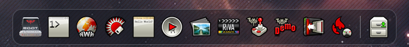
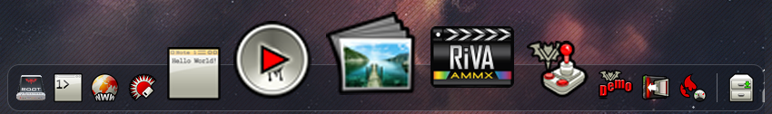

# DockAwesome



A macOS-style dock for the Vampire V4, with live transparency through SAGA PiP.

- Hover to magnify icons and see their names.
- Drop Workbench icons on the dock to pin them. Drag a pin off to remove it.
- Running programs get a dot under their pin, or a temporary icon.
- **Folder Stack** browses a drawer straight from the dock.



## Requirements

- A Vampire V4 (68080 with AMMX).
- ApolloOS R9.5, AmigaOS 3.2.3 or AmigaOS 3.9.
- A 16-bit Workbench screen for live transparency. Other screens get a static
  or solid background.

## Install

Download the `.lha` from [Releases](https://github.com/delwall/DockAwesome/releases).
Copy `DockAwesome` and `DockAwesome.info` to `SYS:WBStartup` and reboot, or
double-click `DockAwesome`. If you use WBDock, move it to
`SYS:WBStartup/Disabled` so only one dock starts.

## Use

| Action | Result |
| --- | --- |
| Click an icon | Open it |
| Drag a pin along the dock | Reorder it |
| Drag a pin out to **Remove** | Remove it |
| Right-click the dock | **Settings**, **About** or **Quit** |
| Right-click a running program | **Quit**, **Close** or **Keep in Dock** |

**Settings** sets the icon size, the zoom, the screen edge and the Folder
Stack drawer. Pins and settings are saved in `ENVARC:DockAwesome.json`.

Found a bug? Include the version from **About** and the output of
`DockAwesome --caps`. What changed in each release is in
[Release notes](RELEASE_NOTES.md).

## Build

```sh
make host-test host-sanitize   # tests on the host
make                           # build/DockAwesome for the 68080
make release RELEASE="1.0 beta 2"
```

The default toolchain is `~/ApolloCrossDevLocal/Compilers/GCC-6.50-Stable`;
set `TOOLCHAIN` to change it. More in [Architecture](docs/architecture.md),
[Hardware](docs/hardware.md), [PiP](docs/pip-backend.md) and
[Verification](docs/verification.md).
